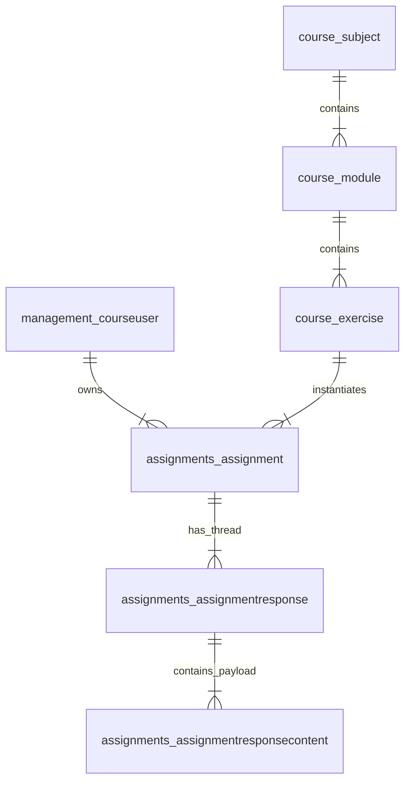

# GEMINI.md - Evaluer Architecture, Conventions & Development Guide

This document outlines the core architecture, design patterns, business rules, API conventions, performance optimizations, and testing guidelines for the `evaluer` codebase.

---

## 1. Project Overview & Architecture

`evaluer` is a high-performance REST API application written in Go designed to calculate course grades, generate student recommendation queues, provide status breakdown analytics, and integrate with the Hive LMS platform.

---

### Codebase Structure

- **`cmd/server/main.go`**: Go application entry point. Loads configuration, initializes PostgreSQL database connection pool (`db.InitDB()`), sets up Gin HTTP routes, and starts the HTTP server.
- **`internal/api/`**:
  - `handlers.go`: Gin HTTP handlers for configuration management and grade calculations.
  - `router.go`: HTTP routing table, CORS preflight middleware, and OPTIONS request handlers.
  - `swagger.go`: OpenAPI 3.0 JSON specification handler and embedded Swagger UI documentation (`/docs`).
- **`internal/dal/dal.go`**: Database Abstraction Layer (DAL). Executes optimized, indexed SQL queries against PostgreSQL concurrently, supporting target student SQL filtering (`WHERE user_id IN (...)`).
- **`internal/db/db.go`**: PostgreSQL database connection pool setup and automatic index creation (`EnsureIndexes`).
- **`internal/cache/cache.go`**: Real-time data fetching engine (`CacheManager`). Executes 6 parallel database queries concurrently over worker goroutines on every request with zero route-level caching.
- **`internal/service/calculator.go`**: Core `GradeCalculator` domain service. Performs real-time grade calculations, unopened exercise filtering, sequential student recommendations, and course status analytics.
- **`internal/config/config.go`**: YAML course configuration manager (`ConfigManager`).
- **`internal/model/models.go`**: Go data models, DB entity structs, clearance level enums, status constants, and API request/response DTOs.
- **`tests/`**: Comprehensive Go unit, integration, and large-scale performance benchmark test suite (`calc_test.go`, `student_filtering_test.go`).

---

## 2. Hive LMS Platform & Domain Object Reference

The Hive LMS platform organizes academic content into a multi-tier hierarchy and tracks student submissions through threaded assignment responses stored in the `core` PostgreSQL database.



### Core Domain & Database Objects

| Object / Model | Database Table | Description & Relationships | Key Attributes & Enums |
| :--- | :--- | :--- | :--- |
| **`Subject`** | `course_subject` | Top-level academic subject container (e.g., Mathematics). Belongs to a program (`parent_program_id`). | `id`, `name`, `parent_program_id` |
| **`Module`** | `course_module` | A learning unit within a subject (e.g., AlgebraBasics). Belongs to a parent subject. | `id`, `name`, `parent_subject_id` |
| **`Exercise`** | `course_exercise` | An individual task or exercise (e.g., QuadraticEq). Belongs to a parent module. | `id`, `name`, `parent_module_id` |
| **`CourseUser`** | `management_courseuser` | User entity in the Hive platform (students, checkers, staff, admins). | `id`, `username`, `first_name`, `last_name`, `clearance` |
| **`Assignment`** | `assignments_assignment` | A student's progress instance for an exercise. Links `user_id` and `exercise_id`. | `id`, `user_id`, `exercise_id`, `assignment_status` |
| **`AssignmentResponse`** | `assignments_assignmentresponse` | A response entry in an assignment thread (`thread_id` $\rightarrow$ `assignments_assignment.id`). | `id`, `thread_id`, `user_id`, `date`, `segel_only`, `response_type` |
| **`AssignmentResponseContent`** | `assignments_assignmentresponsecontent` | Payload text content linked to a response (`response_id`). Contains staff grade text. | `id`, `response_id`, `content`, `field_id` |

### Clearance Levels (`management_courseuser.clearance`)
- **`1`** (`ClearanceHanich`): Student / Participant (Hanich).
- **`2`** (`ClearanceChecker`): Exercise Checker.
- **`3`** (`ClearanceSegel`): Staff Member (Segel).
- **`5`** (`ClearanceAdmin`): System Administrator.

### Assignment Status Integer Mapping (`assignments_assignment.assignment_status`)
In PostgreSQL, `assignment_status` is stored as an integer and mapped to string constants:
- **`0`** $\rightarrow$ `"New"` (`StatusNew`)
- **`1`** $\rightarrow$ `"Work In Progress"` (`StatusWorkInProgress`)
- **`2`** $\rightarrow$ `"Redo"` (`StatusRedo`)
- **`3`** $\rightarrow$ `"Submitted"` (`StatusSubmitted`)
- **`4`** $\rightarrow$ `"AutoChecked"` (`StatusAutoChecked`)
- **`5`** $\rightarrow$ `"Done"` (`StatusDone`)

### Assignment Response Types (`assignments_assignmentresponse.response_type`)
- **`segel_only = True`**: Staff review entries (`Redo`, `Comment`, `Done`).
- **`segel_only = False`**: Student submission entries (`Work In Progress`, `Submission`).

---

## 3. Core Business Rules & Domain Conventions

### Grade & Score Calculation Rules
- **Exercise Score Achieved**:
  $$\text{Exercise Score Achieved} = \frac{\text{raw\_grade}}{100} \times \text{exercise\_config\_score}$$
  `raw_grade` is 100.0 for `DONE`, parsed from review text for `REDO`/`WORK_IN_PROGRESS`, or 0.0 for `NEW`/unopened.
- **Module Grade**:
  $$\text{Module Grade} = \sum_{\text{ex} \in \text{Module}} \text{Exercise Score Achieved} \quad (\text{max } 100.0)$$
  The sum of exercise scores achieved in a module directly equals the module grade (capped at 100.0).
- **Subject Grade**:
  $$\text{Subject Grade} = \frac{\sum_{\text{mod} \in \text{Subject}} (\text{Module Grade}_{\text{mod}} \times \text{module\_weight})}{\sum_{\text{mod} \in \text{Subject}} \text{module\_weight}}$$
  Calculates the weighted average of module grades across configured modules in the subject.
- **Course Grade**:
  $$\text{Course Grade} = \frac{\sum_{\text{sub} \in \text{Course}} (\text{Subject Grade}_{\text{sub}} \times \text{subject\_weight})}{\sum_{\text{sub} \in \text{Course}} \text{subject\_weight}}$$
  Calculates the weighted average of subject grades across configured subjects in the course.

### Unopened Exercise Filtering in Grade Calculations
- **Grade Calculation Routes** (`/calc/exercise`, `/calc/module`, `/calc/subject`, `/calc/course`, `/calc/student`):
  - Exercises that the student has never opened (`assignment is None` / `!hasAssignment`) MUST be **100% excluded** from calculation responses.
  - Only exercises opened or reached by the student are returned.

### Student Recommendation Queue (`/calc/student/recommendations`)
- **Subject Strategy Plan & Target Score Cutoff**: Groups recommendations by subject. Accepts a `target_score` (default: `70.0`) to raise basic subject proficiency. Automatically stops adding exercises to a subject's queue as soon as `projected_grade >= target_score`.
- **Sequential Unreached Recommendations**: Recommends exercises sequentially ($E_1 \rightarrow E_2 \rightarrow E_3$) after prerequisite exercises achieve $\ge 80\%$ grade percentage or `DONE` status.
- **Assignment URL Generation**: Generates valid direct `assignment_url` links (`https://.../course/{sub}/{mod}/{ex}#{student_id}`) even for unreached exercises (`assignment is None`) so students can click to open them.
- **Zero-Weight Filtering**: Exercises in zero-weight subjects (`weight <= 0.0`) or zero-weight modules (`weight <= 0.0`) MUST be skipped and excluded from recommendations.

### Staff Evaluation Tracking (`redo_count` & `is_checked`)
- Each assignment with final status `REDO`, `WORK_IN_PROGRESS`, or `DONE` must be graded. Assignments with status `DONE` default to 100%. `REDO` and `WORK_IN_PROGRESS` grades are given in a `segel_only == True` response, where text comments are parsed for numeric grades via `ParseGradeFromContent`.
- **`redo_count`**: Dynamically counts staff REDO evaluation responses (`segel_only == True` and `response_type == "Redo"`) from assignment response history.
- **`is_checked`**:
  - `True`: Assignment status is `DONE` (`5`), assignment status is `NEW` (`0`), or latest staff review date $\ge$ latest student submission date.
  - `False`: Student submitted/resubmitted code after the last staff review on an active submission (`REDO`, `WORK_IN_PROGRESS`, `SUBMITTED`), or staff has not reviewed the submission yet.

### Course Status Breakdown Route (`/calc/course/status`)
- Reports summary counts across exercise, module, subject, and course levels.
- Includes standard statuses (`DONE`, `REDO`, `WORK_IN_PROGRESS`, `SUBMITTED`, `NEW`) as well as unchecked counters:
  - **`REDO_UNCHECKED`**: `status == REDO` and `not is_checked`.
  - **`WIP_UNCHECKED`**: `status == WORK_IN_PROGRESS` and `not is_checked`.
- **Unopened exercises** (`!hasAssignment`) are strictly excluded from status breakdown counters.

### JSON to YAML Key & Value Sequence Preservation
- When converting JSON payloads to YAML configurations (`config.ConvertJSONToYAML`), the exact sequence of keys and values MUST be preserved.
- Map keys and nested objects are decoded into AST nodes (`yaml.Node`) to retain original insertion order without alphabetical re-sorting.

---

## 4. Database & Performance Conventions

- **Real-Time DB Queries (No Inter-Request Caching)**: Inter-request caching is completely disabled. Every API request dynamically queries the PostgreSQL database in real-time to fetch the most up-to-date assignments, responses, exercises, and student data.
- **SQL-Level Target Filtering**: For student-specific API requests (`/calc/student`, `/calc/student/recommendations`), SQL queries use `WHERE user_id IN (...)`, fetching only target rows and providing a **53x reduction in data payload**.
- **High-Concurrency Parallel Prefetching**: Data fetching uses 6 parallel goroutines via `sync.WaitGroup` to fetch all database entities concurrently over worker connections in a single batch.
- **Database Indexing**: Automatic creation of composite indexes on `assignments_assignment(user_id, exercise_id)`, `assignments_assignmentresponse(thread_id, segel_only)`, and `management_courseuser(clearance)` ensures sub-5ms index scans.
- **Performance Standard**: Sub-25ms execution time for single-student and course-wide routes across 4,000 exercises and 53 students.

---

## 5. Development & Testing Guidelines

- **Run Test Suite**:
  ```powershell
  & "C:\Program Files\Go\bin\go.exe" test -v -count=1 ./...
  ```
- **Rule of Verification**: Never declare a task complete without running the full test suite and confirming 100% pass rate.
