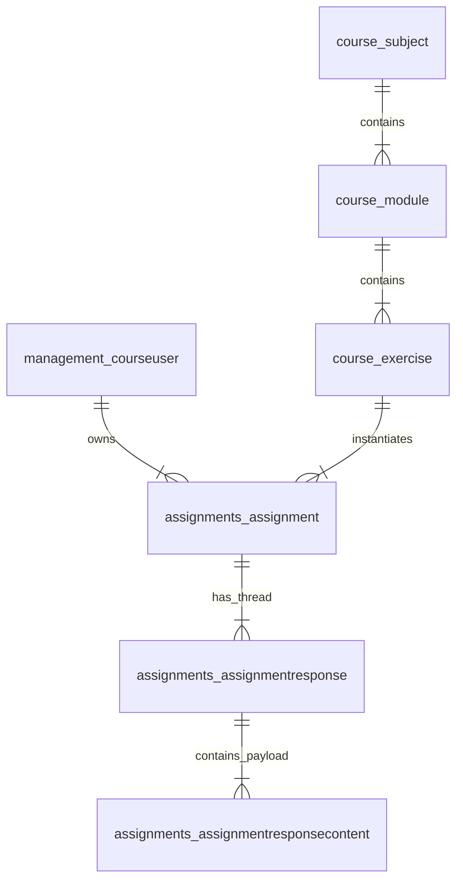

# GEMINI.md - Evaluer Architecture, Conventions & Development Guide

This document outlines the core architecture, design patterns, business rules, API conventions, and testing guidelines for the `evaluer` codebase.

---

## 1. Project Overview & Architecture

`evaluer` is a high-performance RESTAPI application designed to calculate course grades, generate student recommendation queues, provide status breakdown analytics, and integrate with the Hive LMS platform.

---

### Codebase Structure

- **`evaluer/dal`**: Database Abstraction Layer (DAL), a feature of web2py, is an API that converts objects into database objects, including queries, tables, and records. this folder manages all the queries to the postgres database
- **`evaluer/services/calculator.py`**: Core `GradeCalculator` domain service. Handles grade aggregations, unopened exercise filtering, sequential recommendations, and course status analytics.
- **`evaluer/services/config/`**: YAML course configuration parser (`ConfigReader`, `CourseConfig`, `SubjectConfig`, `ModuleConfig`, `ExerciseConfig`).
- **`evaluer/services/cache.py`**: Thread-safe, 100% in-memory (RAM) `CacheManager`.
- **`evaluer/api/`**: FastAPI routes (`calc.py`, `config.py`), schemas (`schemas.py`), and dependencies (`deps.py`).
- **`tests/`**: Comprehensive pytest unit and integration test suite.

---

## 2. Hive LMS Platform & Domain Object Reference

The Hive LMS platform organizes academic content into a multi-tier hierarchy and tracks student submissions through threaded assignment responses stored in the `core` PostgreSQL database.



### Core Domain & Database Objects

| Object / Model | Database Table | Description & Relationships | Key Attributes & Enums |
| :--- | :--- | :--- | :--- |
| **`Subject`** | `course_subject` | Top-level academic subject container (e.g., Mathematics). Belongs to a program (`parent_program_id`). | `id`, `name`, `parent_program_id` |
| **`Module`** | `course_module` | A learning unit within a subject (e.g., AlgebraBasics). Belongs to a parent subject. | `id`, `name`, `parent_subject_id` |
| **`Exercise`** | `course_exercise` | An individual task or exercise (e.g., QuadraticEq). Belongs to a parent module. | `id`, `name`, `parent_module_id` |
| **`CourseUser`** | `management_courseuser` | User entity in the Hive platform (students, checkers, staff, admins). | `id`, `username`, `first_name`, `last_name`, `clearance` |
| **`Assignment`** | `assignments_assignment` | A student's progress instance for an exercise. Links `user_id` and `exercise_id`. | `id`, `user_id`, `exercise_id`, `assignment_status` |
| **`AssignmentResponse`** | `assignments_assignmentresponse` | A response entry in an assignment thread (`thread_id` $\rightarrow$ `assignments_assignment.id`). | `id`, `thread_id`, `user_id`, `date`, `segel_only`, `response_type` |
| **`AssignmentResponseContent`** | `assignments_assignmentresponsecontent` | Payload text content linked to a response (`response_id`). Contains staff grade text. | `id`, `response_id`, `content`, `field_id` |

### Clearance Levels (`management_courseuser.clearance`)
- **`1`** (`ClearanceLevel.HANICH`): Student / Participant (Hanich).
- **`2`** (`ClearanceLevel.CHECKER`): Exercise Checker.
- **`3`** (`ClearanceLevel.SEGEL`): Staff Member (Segel).
- **`5`** (`ClearanceLevel.ADMIN`): System Administrator.

### Assignment Status Integer Mapping (`assignments_assignment.assignment_status`)
In PostgreSQL, `assignment_status` is stored as an integer and mapped to string enums:
- **`0`** $\rightarrow$ `"New"` (`AssignmentStatus.NEW`)
- **`1`** $\rightarrow$ `"Work In Progress"` (`AssignmentStatus.WORK_IN_PROGRESS`)
- **`2`** $\rightarrow$ `"Redo"` (`AssignmentStatus.REDO`)
- **`3`** $\rightarrow$ `"Submitted"` (`AssignmentStatus.SUBMITTED`)
- **`4`** $\rightarrow$ `"AutoChecked"` (`AssignmentStatus.AUTO_CHECKED`)
- **`5`** $\rightarrow$ `"Done"` (`AssignmentStatus.DONE`)

### Assignment Response Types (`assignments_assignmentresponse.response_type`)
- **`segel_only = True`**: Staff review entries (`Redo`, `Comment`, `Done`).
- **`segel_only = False`**: Student submission entries (`Work In Progress`, `Submission`).


---

## 3. Core Business Rules & Domain Conventions

### Unopened Exercise Filtering in Grade Calculations
- **Grade Calculation Routes** (`/calc/exercise`, `/calc/module`, `/calc/subject`, `/calc/course`, `/calc/student`):
  - Exercises that the student has never opened (`status is None` / `assignment is None`) MUST be **100% excluded** from calculation responses.
  - Only exercises opened or reached by the student are returned.

### Student Recommendation Queue (`/calc/student/recommendations`)
- **Subject Strategy Plan & Target Score Cutoff**: Groups recommendations by subject. Accepts a `target_score` (default: `70.0`) to raise basic subject proficiency. Automatically stops adding exercises to a subject's queue as soon as `projected_grade >= target_score`.
- **Sequential Unreached Recommendations**: Recommends exercises sequentially ($E_1 \rightarrow E_2 \rightarrow E_3$) after prerequisite exercises achieve $\ge 80\%$ grade percentage or `DONE` status. No arbitrary priority string fields.
- **Assignment URL Generation**: Generates valid direct `assignment_url` links (`https://.../course/{sub}/{mod}/{ex}#{student_id}`) even for unreached exercises (`assignment is None`) so students can click to open them.
- **Zero-Weight Filtering**: Exercises in zero-weight subjects (`weight <= 0.0`) or zero-weight modules (`weight <= 0.0`) MUST be skipped and excluded from recommendations.

### Staff Evaluation Tracking (`redo_count` & `is_checked`)
- each assignment with final statuses `REDO`/`WORK_IN_PROGRESS`/`DONE` must be graded. assignments with status `DONE`, their grade is default 100. `REDO` & `WORK_IN_PROGRESS` grades are given in a `segel_only == True` response and comment is exracted and represents the grade.
- **`redo_count`**: Dynamically counts staff REDO evaluation responses (`segel_only == True` and `response_type == AssignmentResponseType.REDO`) from assignment response history.
- **`is_checked`**:
  - `True`: Latest staff review date $\ge$ latest student submission date.
  - `False`: Student submitted/resubmitted code after the last staff review, or staff has not reviewed the submission yet.

### Course Status Breakdown Route (`/calc/course/status`)
- Reports summary counts across exercise, module, subject, and course levels.
- Includes standard statuses (`DONE`, `REDO`, `WORK_IN_PROGRESS`, `SUBMITTED`, `NEW`) as well as unchecked counters:
  - **`REDO_UNCHECKED`**: `status == REDO` and `not is_checked`.
  - **`WIP_UNCHECKED`**: `status == WORK_IN_PROGRESS` and `not is_checked`.

---

## 4. Caching & Performance Conventions

- **100% RAM Caching (Zero Disk Persistence)**: All API response caching resides strictly in RAM (`CacheManager` in memory). Writing to disk or persistent file caches is prohibited.
- **Dynamic Calculation on Every Request**: Every API request dynamically re-evaluates all subject/module weights, exercise scores, course summaries, recommendations, and status counts from scratch. No full route-level caching.
- **High-Concurrency Parallel Prefetching**: When fetching fresh data or on cold runs, prefetching uses parallel goroutines to fetch raw Hive API data concurrently in a single batch.
- **OPTIONS Method & CORS Preflight**: All API routes expose explicit `OPTIONS` preflight handlers returning `200 OK` with valid CORS headers.
- **Preformance** Each hot route should take in the worst case five seconds. The applications DB calls are efficient as possible

  ```
- **Rule of Verification**: Never declare a task complete without running the full test suite and confirming 100% pass rate.
